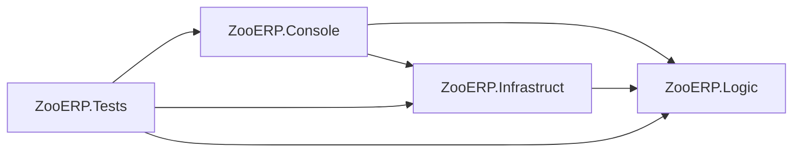

# ZooERP

Консольное приложение для учёта животных и инвентаря зоопарка на C# / .NET 8. Учебный проект по конструированию программного обеспечения: разделение бизнес-логики, инфраструктуры и интерфейса, внедрение зависимостей и модульные тесты.

## Возможности

- Приём животных с проверкой здоровья через ветеринарную клинику.
- Учёт предметов и общая последовательность инвентарных номеров.
- Расчёт суточной потребности животных в корме.
- Выбор животных для контактного зоопарка по типу питания и доброте.
- Русскоязычное меню с проверкой ввода.

## Быстрый старт

Требуется **.NET SDK 8.0**. Выполните команды из папки проекта:

```bash
dotnet restore ZooERP.sln
dotnet run --project ZooERP.Console
```

В меню выберите действие цифрой. Для завершения введите `0`.

## Пример работы

1. Выберите `1` и добавьте кролика: кличка `Снежок`, корм `2`, доброта `8`, здоровье `9`.
2. Выберите `2` и добавьте `кормушка`.
3. Выберите `3`: общая потребность составит **2 кг корма в сутки**.
4. Выберите `4`, оставив порог пустым: Снежок попадёт в контактный зоопарк.
5. Выберите `5`: у кролика будет номер **1**, у кормушки — **2**.

## Правила

| Параметр | Правило |
| --- | --- |
| Здоровье 0–4 | Отказ в приёме |
| Здоровье 5–7 | Приём с сообщением о необходимости лечения |
| Здоровье 8–10 | Приём здорового животного |
| Контактный зоопарк | Травоядные с добротой строго выше порога (по умолчанию 6) |
| Порядок контактного списка | По убыванию доброты, затем по кличке |
| Инвентарные номера | Общие для животных и предметов, начиная с 1 |

В учебной модели кролики и обезьяны относятся к травоядным, тигры и волки - к хищникам. Доброта: 1–10, корм: целое неотрицательное количество килограммов в сутки. Предметы: стол, компьютер, кормушка, клетка.

## Архитектура



| Проект | Ответственность |
| --- | --- |
| `ZooERP.Logic` | Модели, интерфейсы, результаты операций и `ZooService` |
| `ZooERP.Infrastruct` | Хранилище в памяти, генератор номеров и правила ветклиники |
| `ZooERP.Console` | Меню, локализация, регистрация зависимостей через Microsoft.Extensions.DependencyInjection |
| `ZooERP.Tests` | Модульные тесты MSTest |

`ZooService` получает `IZooStore`, `IVetClinic` и `IInventoryNumberGenerator` через конструктор. Это позволяет подменять зависимости при тестировании. Консольный проект связывает реализации с интерфейсами.

## Проверка

```bash
dotnet build ZooERP.sln -c Release
dotnet test ZooERP.sln -c Release
```

Для самостоятельного измерения покрытия:

```bash
dotnet test ZooERP.sln -c Release --collect:"XPlat Code Coverage"
```

Результаты создаются в `TestResults/` и исключены из Git.

## Происхождение

Проект выделен из ветки [kpohw1 репозитория Dz-KPO](https://github.com/elinakocharyan777/Dz-KPO/tree/kpohw1) с сохранением истории этой ветки. Исходный код и тесты при выделении не менялись. [Исходный учебный отчёт](docs/coursework-original.md) сохранён отдельно.
